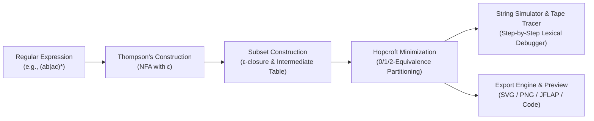

# Visual Automata Studio — Compiler Theory (FCIS '26)

[](tests/)
[](public/manifest.webmanifest)
[](dist/index.html)
[](#-authoritative-fcis-26-course-presets)
[](LICENSE)

> **Interactive Formal Automata Visualizer & Lexical Analysis Studio**  
> Complete end-to-end pedagogical pipeline: **Regular Expressions → Thompson's Construction NFA → Subset Construction DFA → Hopcroft Minimization & Equivalence Partitioning**.

---

## 🌟 Overview

**Visual Automata Studio** is an interactive, installable Progressive Web Application (PWA) engineered specifically for **FCIS '26 Compiler Theory**. It provides students, educators, and compiler developers with an intuitive, mathematically grounded environment to model, inspect, trace, and export finite automata in real time.

- **100% Offline Standalone Application**: Bundled into a zero-dependency, self-executing single HTML document (`dist/index.html`) using `vite-plugin-singlefile`. Runs offline locally with zero CORS restrictions (`file:///...`).
- **PWA Ready**: Equipped with a Web App Manifest (`public/manifest.webmanifest`) and an offline Service Worker (`public/sw.js`) for full installation on Desktop, iOS, and Android.
- **Academic Course Alignment**: Directly implements the curriculum specifications from FCIS Lectures 1–4 and Labs 1–4 (NFA transition tables, Subset Construction intermediate tables with _Appears In_ / _Goes To_ closures, 0/1/2-Equivalence Hopcroft Minimization rounds, and formal 5-tuple language definitions).
- **Interactive SVG Canvas Engine**: 60+ FPS drag-and-drop state repositioning, quadratic Bezier transition curve bending, sliding label badges, dynamic grid transformation, double-click state creation, and intelligent symbol merging.
- **Stepped Lexeme Debugger**: Step-by-step tape tracer with real-time character transitions, active state glow animations, and instant trap-state detection ($\varphi$).
- **Export Preview & Watermark System**: Live interactive preview popup before downloading Vector SVG, High-Res PNG ($2\times$–$3\times$ scale), JFLAP 7.x (`.jff`) XML, and C# state machine / Mermaid diagram code.

---

## 🏗️ Architecture & Pipeline



---

## 📚 Authoritative FCIS '26 Course Presets

The catalog in [`src/core/registry.ts`](file:///D:/02-Projects/01-Development/01-Active/lexical-analysis-program/src/core/registry.ts) is strictly sorted in ascending academic order:

| Index | Course Stage | Preset Name |  Regular Expression   | Formal Description                                                |
| :---: | :----------- | :---------- | :-------------------: | :---------------------------------------------------------------- |
| **1** | Lecture 3    | Identifiers | `(a\|b)(a\|b\|0\|1)*` | Standard variable identifiers over letters and digits             |
| **2** | Lab 3        | Exercise 1  |      `(ab\|c)*`       | Alternation inside Kleene star with different length branches     |
| **3** | Lab 3        | Exercise 2  |      `(a\|b)*a`       | Strings ending with symbol "a"                                    |
| **4** | Lab 3        | Self Study  |     `a*b(a\|b)*`      | Strings containing at least one occurrence of "b"                 |
| **5** | Lecture 4    | Slide 47    |       `a\|abc*`       | Lecture assignment requiring 3 accepted and 3 rejected strings    |
| **6** | Lab 4        | Example 1   |      `(ab\|ac)*`      | Alternation of concatenations; canonical Lab 4 benchmark          |
| **7** | Lab 4        | Example 2   |  `(a\|b)*a(a\|b\|ε)`  | Demonstrates intermediate Appears / Goes-to $\varepsilon$-closure |
| **8** | Lab 4        | Example 3   |   `(ba)+(a*b*\|a*)`   | Positive closure loopback with nested subsets                     |

---

## 📸 Export Preview & Watermark Branding

### Live Export Preview Modal

Clicking **Vector SVG**, **High-Res PNG**, or **JFLAP Diagram** in the toolbar opens the **Export Preview Modal** before saving:

- **Interactive Inspection**: Real-time rendering of the diagram or XML code.
- **Metadata Badges**: Shows target file name, export dimensions (e.g. $2600\times1570\text{ px}$ for PNG), format tag, and watermark indicator.
- **Direct Download**: Confirm via "Download [Format]" or cancel without modifying local state.

### Watermark Branding System

Exported SVG and PNG images feature an unobtrusive branding mark at the bottom right:
`[ logo + Automata Studio ]`

The watermark is hardcoded and controlled in [`src/config/export.config.ts`](file:///D:/02-Projects/01-Development/01-Active/lexical-analysis-program/src/config/export.config.ts):

```typescript
export const config = {
  watermark: true, // set to false to completely remove the watermark
};
```

---

## 📱 Progressive Web App (PWA) & Offline Usage

Visual Automata Studio is engineered as an offline-first PWA:

- **Installation**: Can be installed to your desktop or mobile home screen via browser prompt ("Install App").
- **Offline Reliability**: The Service Worker caches application assets (`index.html`, `manifest.webmanifest`, icons) so the app functions seamlessly without internet access.
- **Mobile Responsive**: Fully responsive down to $360\text{ px}$ viewports. Tables support horizontal touch-scrolling, and toolbar symbols wrap smoothly.

---

## 🛠️ Getting Started

### Prerequisites

- [Node.js](https://nodejs.org/) v18+ or v20+
- npm v9+

### Installation & Local Development

```bash
# Clone the repository
git clone https://github.com/3mr-5aled/Lexical_Analysis_Program.git
cd Lexical_Analysis_Program

# Install dependencies
npm install

# Start Vite dev server
npm run dev
```

### Standalone Single-File Build

```bash
npm run build
```

The compiled output is saved to `dist/index.html`. You can distribute or open this single file directly in any web browser without running a web server.

### Running Automated Test Suite

```bash
npm test
```

Runs all **59 automated tests** via Node test runner across:

- `tests/canvas-performance.test.js`: Interactive click, drag, pan, and state/transition creation
- `tests/export.test.js`: SVG, PNG, JFLAP, and code modal export validation with watermark checks
- `tests/pwa-responsive.test.js`: Manifest, service worker, and mobile viewport assertions
- `tests/pipeline.test.js`: End-to-end compiler pipeline for all 8 course presets
- `tests/thompson.test.js` & `tests/subset.test.js`: NFA and DFA state generation
- `tests/hopcroft.test.js`: 0/1/2-Equivalence partitioning and partition splits
- `tests/tracer.test.js` & `tests/simulator.test.js`: Character tape stepping and trap routing

---

## 🚢 Deployment

For complete hosting guides on **GitHub Pages**, **Vercel**, **Netlify**, or local execution, consult [`docs/DEPLOYMENT.md`](file:///D:/02-Projects/01-Development/01-Active/lexical-analysis-program/docs/DEPLOYMENT.md).

---

## 👥 Authors & Credits

Developed with ❤️ for **Faculty of Computers and Artificial Intelligence (FCIS '26)** by:

- **Amr Khaled** — [@3mr-5aled](https://github.com/3mr-5aled)
- **Abdelmoaty Leklaka** — [@Leklaka-Abdelmoaty](https://github.com/Leklaka-Abdelmoaty)

---

## 📄 License & Versioning

- **License**: MIT License
- **Version**: `1.0.0`
- **Changelog**: See [`CHANGELOG.md`](file:///D:/02-Projects/01-Development/01-Active/lexical-analysis-program/CHANGELOG.md) for full version history.
