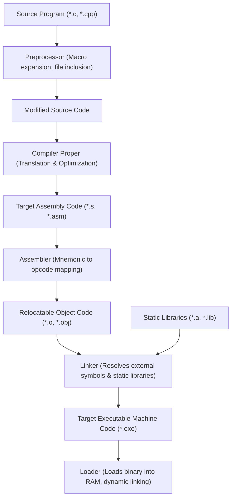
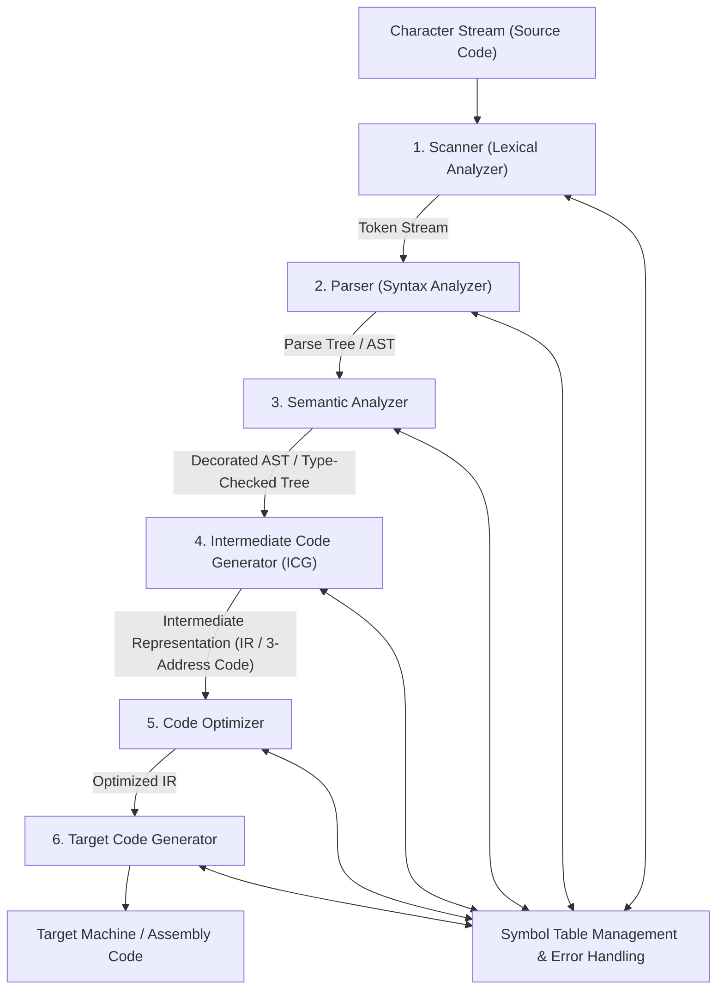

# 01. Compiler Architecture & Lexical Analysis

> **Academic Provenance:** FCIS '26 Compilers Theory — Lecture 1 (Introduction & Lexical Analysis), Lab 1 (Course Orientation & Intro), Lab 2 (Scanning Phase & Regex), Lab 3 (Lexical Scanner Design).

---

## 1. High-Level Compiler Overview

### 1.1 What is a Compiler?
A **compiler** is a specialized computer program that translates a program written in a high-level **source language** (such as C, C++, Java, or C#) into an equivalent program in a low-level **target language** (such as assembly language, machine code, or bytecode).

Key functions of a compiler:
1. **Semantic Equivalence:** Preserves the exact meaning and computational behavior of the source program.
2. **Target Optimization:** Generates efficient code tailored to the target execution environment.
3. **Diagnostic Reporting / Error Prevention:** Detects, reports, and diagnoses static errors (lexical, grammatical, and semantic) with precise source code locations before runtime.

### 1.2 Compiler vs. Interpreter
| Feature | Compiler | Interpreter |
| :--- | :--- | :--- |
| **Execution Model** | Translates entire source code into machine code prior to execution. | Reads, translates, and executes the source code line-by-line / statement-by-statement. |
| **Execution Speed** | Very fast runtime execution once compiled. | Slower runtime execution due to continuous interpretation overhead. |
| **Memory Footprint** | Output executable is standalone; does not require the compiler at runtime. | Requires the interpreter program to be resident in memory during execution. |
| **Error Discovery** | Reports all static errors prior to execution. | Uncovers errors only when the specific execution path containing the error is hit. |
| **Examples** | C, C++, Rust, Go, Fortran. | Python, Ruby, PHP, JavaScript (in classic engines). |

---

## 2. The Complete Language Processing Toolchain

A compiler proper operates within a broader software toolchain that transforms human-written source files into executable binaries loaded into system RAM:



---

## 3. Stages Within a Compiler Proper

A traditional compiler is divided into two primary logical halves:
1. **Analysis Phase (Front-End):** Language-dependent; breaks down the source program into an intermediate representation and builds the symbol table.
2. **Synthesis Phase (Back-End):** Target-machine-dependent; optimizes the intermediate representation and generates final machine code.

The front-end and back-end are broken into six sequential phases:



### Detailed Breakdown of the 6 Phases

1. **Scanner (Lexical Analysis):**
   - **Input:** Raw stream of characters from the source file.
   - **Output:** Stream of discrete, typed **tokens**.
   - **Responsibility:** Strips comments and whitespace, tracks line numbers for error reporting, enters identifiers into the Symbol Table.

2. **Parser (Syntax Analysis):**
   - **Input:** Token stream.
   - **Output:** Parse Tree or **Abstract Syntax Tree (AST)**.
   - **Responsibility:** Verifies that tokens satisfy the grammatical rules of the language defined by a Context-Free Grammar (CFG).

3. **Semantic Analyzer:**
   - **Input:** AST and Symbol Table.
   - **Output:** Type-checked, decorated AST.
   - **Responsibility:** Enforces static semantics: type checking, variable declaration before use, scope resolution, function signature matching, and array bound checking.

4. **Intermediate Code Generator (ICG):**
   - **Input:** Decorated AST.
   - **Output:** Linear, machine-independent Intermediate Representation (IR), commonly **Three-Address Code (3AC)** or quadruples.
   - **Responsibility:** Decouples language syntax from target architecture.

5. **Code Optimizer:**
   - **Input:** Raw IR.
   - **Output:** Optimized IR.
   - **Responsibility:** Applies semantics-preserving transformations to make the program run faster or consume less memory (e.g., constant folding, dead code elimination, loop-invariant code motion).

6. **Target Code Generator:**
   - **Input:** Optimized IR.
   - **Output:** Target assembly or machine code.
   - **Responsibility:** Assigns memory addresses, allocates hardware registers, selects native machine instructions.

---

## 4. Deep Dive: The Scanner (Lexical Analyzer)

### 4.1 Fundamental Terminology: Lexeme, Token, Pattern
The lexical analyzer operates using three precise concepts:

| Concept | Formal Definition | Concrete Examples |
| :--- | :--- | :--- |
| **Token** | An abstract grammatical category representing a unit of source code. Represented as a tuple: `<token_name, attribute_value>`. | `KEYWORD`, `IDENTIFIER`, `NUMBER`, `ASSIGN_OP`, `SEMICOLON`. |
| **Pattern** | A formal descriptive rule (specified via **Regular Expressions**) that characters must match to form a token. | `[a-zA-Z_][a-zA-Z0-9_]*` for identifiers; `[0-9]+(\.[0-9]+)?` for numbers. |
| **Lexeme** | The actual concrete sequence of characters in the source text that matches the pattern for a token. | `while`, `total_sum`, `3.14159`, `:=`, `;`. |

#### Example Tokenization
For the source code fragment:
```c
position = initial + rate * 60;
```
The scanner generates the token stream:
1. `<ID, "position">`
2. `<ASSIGN_OP, "=">`
3. `<ID, "initial">`
4. `<ADD_OP, "+">`
5. `<ID, "rate">`
6. `<MUL_OP, "*">`
7. `<INT_CONST, 60>`
8. `<SEMICOLON, ";">`

---

## 5. Token Classification & Typical Regex Specifications

### 5.1 Reserved Words / Keywords
Fixed strings predefined by the language syntax.
- **Examples:** `if`, `else`, `while`, `for`, `int`, `return`, `program`, `declare`.
- **Regex:** Literal exact strings (e.g., `w \cdot h \cdot i \cdot l \cdot e`).

### 5.2 Identifiers
User-defined names for variables, functions, types, and classes.
- **Rule:** Must begin with a letter or underscore, followed by zero or more letters, digits, or underscores.
- **Regex Specification:**
  $$\text{Letter} \to [a-zA-Z\_]$$
  $$\text{Digit} \to [0-9]$$
  $$\text{Identifier} \to \text{Letter} \, (\text{Letter} \mid \text{Digit})^*$$

### 5.3 Numeric Constants (Literals)
1. **Integers:**
   $$\text{Digits} \to [0-9]^+$$
2. **Floating-Point Real Numbers:**
   $$\text{OptionalFraction} \to (\cdot [0-9]^+)?$$
   $$\text{OptionalExponent} \to ([eE][+\-]?[0-9]^+)?$$
   $$\text{FloatLiteral} \to [0-9]^+ \cdot [0-9]^+ \, \text{OptionalExponent}$$

### 5.4 Operators
Single or multi-character symbols denoting computational operations:
- Arithmetic: `+`, `-`, `*`, `/`, `%`
- Relational: `==`, `!=`, `<`, `<=`, `>`, `>=`
- Logical: `&&`, `||`, `!`
- Assignment: `=`, `:=`, `+=`, `-=`

### 5.5 Delimiters & Punctuation
Syntactic separators: `;`, `,`, `:`, `(`, `)`, `{`, `}`, `[`, `]`.

### 5.6 Whitespace & Comments
Sequences discarded by the scanner after separating adjacent lexemes:
- Whitespace: `[ \t\r\n]+`
- Single-line comments: `//[^\n]*\n`
- Multi-line comments: `/\*([^*]|\*+[^*/])*\*+/`

---

## 6. Resolving Lexical Ambiguity

In many programming languages, multiple token patterns can match the same prefix of characters. Scanners resolve ambiguity using two universal disambiguation rules:

### Rule 1: Longest Match (Maximal Munch)
When multiple patterns can match the incoming characters, the scanner always consumes the longest possible valid prefix.
- **Example:** For the input `<=`, the scanner emits `<REL_OP, "<=">`, rather than `<REL_OP, "<">` followed by `<ASSIGN_OP, "=">`.
- **Example:** For the input `whilevar`, the scanner consumes the entire identifier `whilevar` rather than treating `while` as a keyword.

### Rule 2: Rule Priority (Reserved Words Over Identifiers)
When the longest match satisfies two different patterns of identical length, the pattern declared first takes precedence.
- In practice, **Keywords take precedence over Identifiers**.
- The string `"while"` matches both the keyword `while` and the identifier pattern `Letter(Letter|Digit)*`. Because keywords have higher priority, the scanner produces `<KEYWORD, "while">`.

---

## 7. Course Case Studies: JASON & Rynix Specifications

The FCIS '26 curriculum utilizes two educational languages to test and benchmark lexical scanners:

### 7.1 The JASON Language (Lab 3)
*JASON* stands for **Just Another Simple Original Notion**.
- **Case Sensitivity:** Case-insensitive.
- **Keywords (20 total):**
  `BEGIN`, `CALL`, `DECLARE`, `DO`, `ELSE`, `END`, `ENDIF`, `ENDUNTIL`, `ENDWHILE`, `IF`, `INTEGER`, `PARAMETERS`, `PROCEDURE`, `PROGRAM`, `READ`, `REAL`, `SET`, `THEN`, `UNTIL`, `WHILE`, `WRITE`.
- **Identifier Pattern:**
  $$\text{Letter} \to [A-Za-z]$$
  $$\text{Digit} \to [0-9]$$
  $$\text{Identifier} \to \text{Letter} \, (\text{Letter} \mid \text{Digit})^*$$
- **Numeric Constant Pattern:**
  $$\text{Constant} \to [0-9]^* (\cdot [0-9]^+)?$$
- **Operators:** `>`, `<`, `!`, `=`, `+`, `-`, `*`, `/`
- **Delimiters:** `.`, `;`, `,`, `(`, `)`, `{`, `}`

### 7.2 The Rynix Language (Lab 3 & Lab 4 Milestone)
Rynix expands JASON's token vocabulary to include comparison operators (`==`, `!=`, `<=`, `>=`), assignment (`:=`), string literals delimited by quotes, and multi-line comments.
