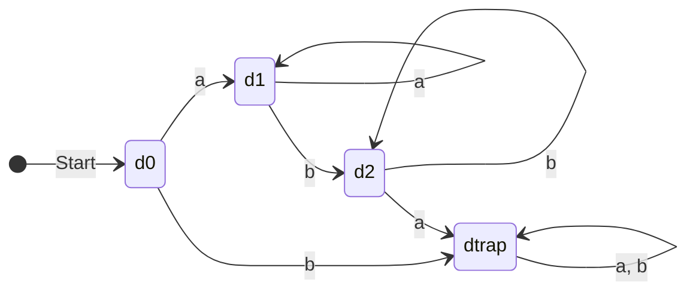
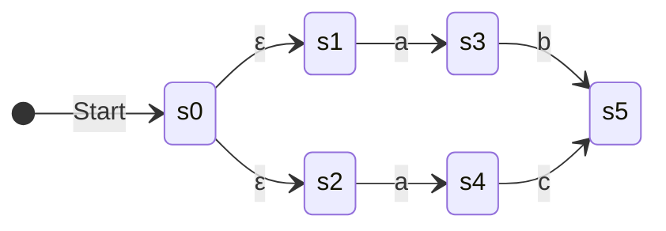

# 03. Finite Automata Theory: DFA & NFA

> **Academic Provenance:** FCIS '26 Compilers Theory — Lecture 2 (Finite Automata, DFA vs NFA), Lab 2 (FSA Exercises & C# Scanner Implementation).

---

## 1. Formal Mathematical Definition of Finite Automata

A **Finite State Automaton (FA)** or **Finite State Machine (FSM)** is an abstract mathematical model of computation consisting of a finite collection of states, transitions between those states triggered by input symbols, an initial state, and a set of accepting states.

Formally, a Finite Automaton $M$ is defined as a 5-tuple:
$$M = (Q, \Sigma, \delta, q_0, F)$$

Where:
1. **$Q$:** A finite, non-empty set of **states**.
2. **$\Sigma$:** A finite, non-empty set of **input symbols** (the alphabet).
3. **$\delta$:** The **transition function** describing how the machine moves between states upon reading symbols.
4. **$q_0 \in Q$:** The **initial (start) state** where computation begins. In state transition diagrams, it is indicated by an incoming arrow without a source: $\to q_0$.
5. **$F \subseteq Q$:** The set of **accepting (final) states**. In diagrams, accepting states are drawn with a **concentric double circle** or marked with an asterisk: $q^*$.

---

## 2. Deterministic Finite Automata (DFA)

### 2.1 Formal Definition & Core Constraints
A Finite Automaton is **Deterministic (DFA)** if and only if its transition function is total and deterministic:
$$\delta: Q \times \Sigma \to Q$$

This imposes two mandatory structural constraints:
1. **Uniqueness:** For every state $q \in Q$ and every input symbol $a \in \Sigma$, there is **at most one** (or exactly one in a complete DFA) transition.
2. **No Epsilon Moves:** There are **zero $\varepsilon$-transitions** ($\delta(q, \varepsilon)$ is strictly undefined). The machine cannot change states without consuming an input symbol from $\Sigma$.



### 2.2 Complete DFAs vs. Dead / Sink / Trap States ($\Phi$)
In formal compiler theory and the FCIS '26 curriculum:
- A **Complete DFA** explicitly specifies a transition for *every* symbol in $\Sigma$ from *every* state in $Q$.
- If a state has no valid forward transition for a character $a \in \Sigma$, it transitions into a dedicated **Dead State** (also called a **Trap State** or **Sink State**, denoted as $\Phi$ or $d_{\text{trap}}$).

#### Properties of the Trap State ($\Phi$):
1. **Non-Accepting:** $\Phi \notin F$. Once in the trap state, the string can never be accepted.
2. **Absorbing (Self-Looping):** For all $a \in \Sigma$, $\delta(\Phi, a) = \Phi$.
3. **Error Recognition:** In a compiler scanner, reaching $\Phi$ immediately signals a **Lexical Error**.

### 2.3 Extended Transition Function ($\hat{\delta}$)
To trace execution over an entire string $w \in \Sigma^*$, the transition function is extended inductively to $\hat{\delta}: Q \times \Sigma^* \to Q$:
- **Base Case (Empty String):**
  $$\hat{\delta}(q, \varepsilon) = q$$
- **Inductive Step:** For any string $w = xa$ (where $x \in \Sigma^*$, $a \in \Sigma$):
  $$\hat{\delta}(q, xa) = \delta(\hat{\delta}(q, x), a)$$

### 2.4 Language Acceptance Condition
A string $w \in \Sigma^*$ is **accepted** by a DFA $M$ if and only if the machine finishes reading $w$ in an accepting state:
$$w \in L(M) \iff \hat{\delta}(q_0, w) \in F$$

If $\hat{\delta}(q_0, w) \notin F$, the string is **rejected**.

---

## 3. Non-Deterministic Finite Automata (NFA)

### 3.1 Formal Definition & Relaxation of Constraints
An NFA relaxes the determinism constraints of a DFA. Formally, its transition function maps to the power set of states:
$$\delta: Q \times (\Sigma \cup \{\varepsilon\}) \to \mathcal{P}(Q)$$

This permits three key capabilities:
1. **Branching (Multiple Choices):** A state can have multiple outgoing transitions labeled with the same symbol $a \in \Sigma$: $|\delta(q, a)| \ge 0$.
2. **Epsilon ($\varepsilon$) Transitions:** The machine can spontaneously transition between states without consuming any character from the input stream: $\delta(q, \varepsilon) \neq \emptyset$.
3. **Missing Transitions:** If $\delta(q, a) = \emptyset$, that specific computation branch dies silently without needing an explicit trap state.



### 3.2 String Acceptance in an NFA
In an NFA, a single input string can trace multiple alternative computation paths.
A string $w$ is **accepted** by an NFA if and only if **at least one** computation path starting from $q_0$ and consuming $w$ terminates in an accepting state $f \in F$:
$$w \in L(M) \iff \exists \text{ path from } q_0 \text{ to } f \in F \text{ labeled } w$$

---

## 4. DFA vs. NFA: Comprehensive Comparison

| Dimension | Deterministic Finite Automaton (DFA) | Non-Deterministic Finite Automaton (NFA) |
| :--- | :--- | :--- |
| **Next State Computation** | Uniquely determined; exactly 1 target state. | Set of target states (0, 1, or multiple). |
| **Epsilon Moves** | Strictly forbidden ($\varepsilon \notin \text{domain}$). | Allowed ($\varepsilon$-transitions without consuming input). |
| **Simulation Speed** | $O(|w|)$ linear time in string length; simple 2D array lookup. | $O(|Q|^2 \cdot |w|)$ if simulated directly without pre-conversion. |
| **State Space Size** | Can be exponential ($2^{|Q_{\text{NFA}}|}$) in the worst case, but minimal in practice. | Compact; state count is proportional to regular expression length ($O(|r|)$). |
| **Hardware / Software Implementation** | Trivial to implement in table-driven code or fast switch statements. | Hard to execute directly; requires backtracking or parallel state tracking. |
| **Expressive Power** | Recognizes exactly the regular languages. | Recognizes exactly the regular languages ($L(\text{DFA}) = L(\text{NFA})$). |

---

## 5. Tracing the Ambiguity of an NFA (Lecture 2 Case Study)

Lecture 2 illustrates why compilers cannot use raw NFAs directly for scanning:

### Case Study: Scanning Identifiers vs. Keyword `sing`
Suppose an NFA has:
1. A path recognizing any identifier: `[a-z]+`
2. A dedicated path recognizing the specific keyword: `sing`

When given the character stream `s-i-n-g`:
- At each character, the machine faces non-deterministic choice: should it stay on the keyword path, or branch to the generic identifier path?
- If the stream is `s-i-n-k`, following the keyword path causes a premature dead-end on `k`, forcing backtracking to explore the identifier path.
- **Conclusion (Lecture 2 Slide 61):** Because backtracking degrades scanner performance, compilers first convert the NFA into a DFA via **Subset Construction**.

---

## 6. Automata Simulation Algorithm & Rejection Taxonomy

In an interactive visualizer and compiler scanner, string simulation must be robust, deterministic, and educational.

### 6.1 Deterministic Simulation Algorithm
```python
def simulate_dfa(dfa, input_string):
    current_state = dfa.start_state
    trace = [current_state]

    for char in input_string:
        if char not in dfa.alphabet:
            return {
                "accepted": False,
                "reason": f"Character '{char}' is not in the alphabet {dfa.alphabet}",
                "trace": trace
            }

        next_state = dfa.transition_table.get((current_state, char), dfa.trap_state)
        current_state = next_state
        trace.append(current_state)

        if current_state == dfa.trap_state:
            return {
                "accepted": False,
                "reason": f"Transitioned to dead/trap state Φ on symbol '{char}'",
                "trace": trace
            }

    if current_state in dfa.accepting_states:
        return {
            "accepted": True,
            "reason": f"Successfully finished in accepting state {current_state}",
            "trace": trace
        }
    else:
        return {
            "accepted": False,
            "reason": f"Input consumed, but terminated in non-accepting state {current_state}",
            "trace": trace
        }
```

### 6.2 Taxonomy of Rejection Reasons
When a string is rejected, the scanner or test suite categorizes the failure into one of four distinct causes:
1. **Invalid Alphabet Symbol:** The input contains characters $\notin \Sigma$.
2. **Premature Trap Entry:** The string prefix took an illegal transition into $\Phi$.
3. **Incomplete Path (Non-Accepting Finish):** All characters were consumed without entering the trap state, but the ending state $q_{\text{final}} \notin F$.
4. **Length Violation / Empty String Mismatch:** $\varepsilon$ is supplied when the initial state $q_0 \notin F$.
