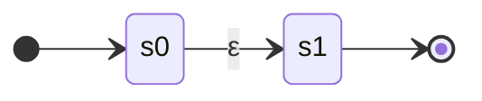
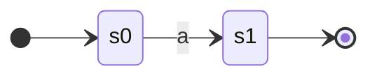
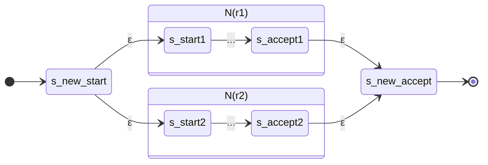
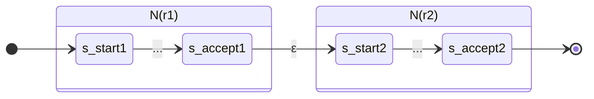
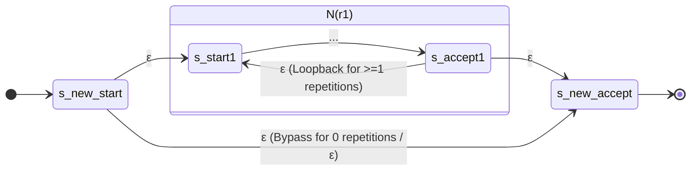

# 04. Thompson's Construction: RE to NFA

> **Academic Provenance:** FCIS '26 Compilers Theory — Lecture 3 (Thompson's Construction), Lab 3 (Thompson NFA In-Class Exercises & Self-Study).

---

## 1. Principles & Theoretical Invariants

Invented by Ken Thompson in 1968, **Thompson's Construction** is a syntax-directed, inductive algorithm that converts any regular expression $r$ into an equivalent Non-Deterministic Finite Automaton $N(r)$ such that:
$$L(N(r)) = L(r)$$

### Fundamental Invariants
Every NFA generated by Thompson's construction strictly satisfies five structural invariants:

1. **Exact Start State:** $N(r)$ has **exactly one initial state** $s_0$. The initial state has **no incoming transitions**.
2. **Exact Accepting State:** $N(r)$ has **exactly one final (accepting) state** $s_f$. The accepting state has **no outgoing transitions**.
3. **Linear State Complexity:** For a regular expression of length $|r|$, the generated NFA contains at most $2|r|$ states:
   $$|Q| \le 2|r|$$
4. **Linear Transition Complexity:** The NFA contains at most $4|r|$ transitions.
5. **Bounded Out-Degree:** Every state has at most two outgoing $\varepsilon$-transitions, and at most one outgoing symbol transition ($a \in \Sigma$).

---

## 2. Canonical Thompson Construction Rules

### Rule 1: Empty String ($\varepsilon$)
For $r = \varepsilon$:

- Creates two states: start $s_0$ and accept $s_1$.
- Adds one transition: $s_0 \xrightarrow{\varepsilon} s_1$.

---

### Rule 2: Single Alphabet Symbol ($a \in \Sigma$)
For $r = a$:

- Creates two states: start $s_0$ and accept $s_1$.
- Adds one transition: $s_0 \xrightarrow{a} s_1$.

---

### Rule 3: Alternation / Union ($r_1 \mid r_2$)
For $r = r_1 \mid r_2$:

1. Recursively construct $N(r_1)$ and $N(r_2)$.
2. Create a new initial state $s_{\text{start}}$ and a new final state $s_{\text{final}}$.
3. Add $\varepsilon$-transitions from $s_{\text{start}}$ to the initial states of $N(r_1)$ and $N(r_2)$.
4. Add $\varepsilon$-transitions from the final states of $N(r_1)$ and $N(r_2)$ to $s_{\text{final}}$.

---

### Rule 4: Concatenation ($r_1 \cdot r_2$)
For $r = r_1 \cdot r_2$:

1. Recursively construct $N(r_1)$ and $N(r_2)$.
2. Connect the final state of $N(r_1)$ to the initial state of $N(r_2)$ via an $\varepsilon$-transition (or merge them into a single joint state).
3. The initial state of $N(r_1)$ becomes the initial state of the compound machine; the final state of $N(r_2)$ becomes the compound final state.

---

### Rule 5: Kleene Closure ($r_1^*$)
For $r = r_1^*$:

1. Recursively construct $N(r_1)$.
2. Create a new initial state $s_{\text{start}}$ and a new final state $s_{\text{final}}$.
3. Add an $\varepsilon$-transition from $s_{\text{start}}$ to the initial state of $N(r_1)$.
4. Add an $\varepsilon$-transition from the final state of $N(r_1)$ to $s_{\text{final}}$.
5. Add an $\varepsilon$-**loopback transition** from the final state of $N(r_1)$ back to its initial state to allow one or more repetitions.
6. Add an $\varepsilon$-**bypass transition** directly from $s_{\text{start}}$ to $s_{\text{final}}$ to allow zero occurrences ($\varepsilon$).

---

### Rule 6: Positive Closure ($r_1^+$)
For $r = r_1^+ \equiv r_1 \cdot r_1^*$:
Constructed identically to Kleene Star, but **without the bypass transition** ($s_{\text{start}} \xrightarrow{\varepsilon} s_{\text{final}}$), ensuring at least one pass through $N(r_1)$.

---

## 3. Sub-Expression Ordering & State Numbering Discipline

In the FCIS '26 curriculum, Thompson's construction is conducted systematically from the bottom up, adhering to operator precedence:

### Standard Lab Step Breakdown
Given an expression such as $r = (ab \mid c)^*$:
1. $r_1 = a$
2. $r_2 = b$
3. $r_3 = r_1 \cdot r_2 = ab$
4. $r_4 = c$
5. $r_5 = r_3 \mid r_4 = ab \mid c$
6. $r_6 = r_5^* = (ab \mid c)^*$

### State Labeling Rule
- States are labeled with contiguous integers starting at $0$: $\{0, 1, 2, \dots, N-1\}$.
- In complex sub-expressions, outer wrapping states (such as the outer start and accept states for union or Kleene star) receive the earliest and latest available numbers, or numbers assigned sequentially as nodes are placed.

---

## 4. Course Reference Constructions

### 4.1 Construction of $r = (ab \mid ac)^*$ (Lab 4 Example 1)
- **Sub-expressions:**
  - $N_1 = ab$: $2 \xrightarrow{a} 3 \xrightarrow{\varepsilon} 4 \xrightarrow{b} 5$
  - $N_2 = ac$: $7 \xrightarrow{a} 8 \xrightarrow{\varepsilon} 9 \xrightarrow{c} 10$
  - Union $ab \mid ac$:
    - Start node $1$ branches to $2$ and $7$ via $\varepsilon$.
    - Accept nodes $5$ and $10$ connect to node $6$ via $\varepsilon$.
  - Kleene Star $(ab \mid ac)^*$:
    - New global start node $0$: $0 \xrightarrow{\varepsilon} 1$ and bypass $0 \xrightarrow{\varepsilon} 11$.
    - Loopback $6 \xrightarrow{\varepsilon} 1$.
    - Exit $6 \xrightarrow{\varepsilon} 11$ (final state $11^*$).

#### Summary of States & Transitions for $(ab \mid ac)^*$
- **Total States:** 12 states ($0$ through $11$).
- **Start State:** $0$
- **Accept State:** $11^*$
- **Epsilon Transitions:**
  - $0 \to 1$, $0 \to 11$
  - $1 \to 2$, $1 \to 7$
  - $3 \to 4$
  - $5 \to 6$, $5 \to 11$ (or through junction $6$)
  - $6 \to 1$, $6 \to 11$
  - $8 \to 9$
  - $10 \to 6$
- **Symbol Transitions:**
  - $2 \xrightarrow{a} 3$
  - $4 \xrightarrow{b} 5$
  - $7 \xrightarrow{a} 8$
  - $9 \xrightarrow{c} 10$

---

### 4.2 Construction of $r = (a \mid b)^* a$ (Lab 3 Exercise 2)
1. $r_1 = a \implies 2 \xrightarrow{a} 3$
2. $r_2 = b \implies 4 \xrightarrow{b} 5$
3. $r_3 = a \mid b \implies 1 \xrightarrow{\varepsilon} 2$, $1 \xrightarrow{\varepsilon} 4$, $3 \xrightarrow{\varepsilon} 6$, $5 \xrightarrow{\varepsilon} 6$
4. $r_4 = (a \mid b)^* \implies 0 \xrightarrow{\varepsilon} 1$, $0 \xrightarrow{\varepsilon} 7$, $6 \xrightarrow{\varepsilon} 1$, $6 \xrightarrow{\varepsilon} 7$
5. $r_5 = a \implies 8 \xrightarrow{a} 9^*$
6. Concatenation $r_6 = r_4 \cdot r_5 \implies 7 \xrightarrow{\varepsilon} 8$ (or merge $7$ with $8$).
- **Start State:** $0$
- **Accepting State:** $9^*$
