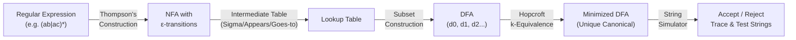

# Map of Content (MOC): FCIS '26 Compilers Theory Knowledge Base

Welcome to the scientific and domain reference knowledge base for the **Interactive Compiler Automata Visualizer and Step-by-Step Solver**. This documentation synthesizes all theoretical lectures, practical labs, formal algorithms, and worked examples from the **FCIS '26 Compilers Theory** curriculum (Lectures 1–4, Labs 1–4, Prof. Zaki Taha, Dr. Mohamed Ali, and TA team).

---

## Knowledge Base Navigation

1. **[[01-Compiler-Architecture-and-Lexical-Analysis|01. Compiler Architecture & Lexical Analysis]]**
   - The Compiler Toolchain (Preprocessor, Compiler, Assembler, Linker/Loader)
   - The 6 Phases of Compiler Proper (Scanner, Parser, Semantic Analyzer, Intermediate Code Generator, Optimizer, Target Code Generator)
   - Scanning Deep Dive: Tokens, Patterns, Lexemes, Symbol Table Attributes
   - Token Classes: Keywords, Identifiers, Numbers (Integers, Floats, Scientific Notation), Operators, Delimiters, Whitespace & Comments
   - Ambiguity Resolution Rules: Longest Match (Maximal Munch) and Keyword Precedence
   - Course Language Specifications: JASON and Rynix

2. **[[02-Regular-Expressions-and-Formal-Languages|02. Regular Expressions & Formal Languages]]**
   - Mathematical Foundations: Alphabets ($\Sigma$), Strings ($w$), Length ($|w|$), Empty String ($\varepsilon$), Languages ($L \subseteq \Sigma^*$)
   - Inductive Definition of Regular Expressions (Base Cases and Inductive Step)
   - Operators & Precedence: Parentheses $>$ Kleene Star ($*$) / Plus ($+$) / Optional ($?$) $>$ Concatenation $>$ Alternation ($|$)
   - Algebraic Laws of Regular Expressions (Identities, Annihilators, Distributivity, Idempotence)
   - High-Yield Course Patterns (No 3 consecutive characters, odd/even counts, bounded substrings)

3. **[[03-Finite-Automata-Theory-DFA-and-NFA|03. Finite Automata Theory: DFA & NFA]]**
   - Formal 5-Tuple Definition of Finite Automaton: $M = (Q, \Sigma, \delta, q_0, F)$
   - Deterministic Finite Automata (DFA): Transition function $\delta: Q \times \Sigma \to Q$, state diagrams, transition tables
   - Non-Deterministic Finite Automata (NFA): Transition function $\delta: Q \times (\Sigma \cup \{\varepsilon\}) \to \mathcal{P}(Q)$, state branching, $\varepsilon$-transitions
   - Complete DFAs & Dead / Trap / Sink States ($\Phi$ or $d_{trap}$)
   - Automata Execution Simulation: String Acceptance, Rejection Criteria, Step-by-Step Trace Formulation

4. **[[04-Thompsons-Construction-RE-to-NFA|04. Thompson's Construction: RE to NFA]]**
   - Theoretical Invariants: Single start state, single accept state, $O(|r|)$ states and transitions
   - Canonical Inductive Construction Rules:
     - Base: Empty string ($\varepsilon$) and single symbol ($a \in \Sigma$)
     - Alternation / Union ($r_1 | r_2$)
     - Concatenation ($r_1 \cdot r_2$)
     - Kleene Closure ($r^*$) and Positive Closure ($r^+$)
   - State Numbering Discipline & Sub-Expression Ordering matching FCIS '26 standards

5. **[[05-Subset-Construction-NFA-to-DFA|05. Subset Construction: NFA to DFA]]**
   - Mathematical Foundations: $\varepsilon\text{-closure}(s)$, $\varepsilon\text{-closure}(T)$, $\text{move}(T, a)$
   - The FCIS '26 Canonical Method & Intermediate Lookup Table:
     - The **"Sigma / Appears / Goes to"** Table
   - Algorithm Steps: Initial state $d_0 = \varepsilon\text{-closure}(s_0)$, state discovery loop, marking start state ($\to$) and accept states ($*$)
   - Trap State ($\Phi$) handling for incomplete transitions
   - DFA Transition Table construction and State Transition Diagram generation

6. **[[06-DFA-Minimization-Equivalence-Partitioning|06. DFA Minimization: Equivalence Partitioning]]**
   - Motivation: Myhill-Nerode Theorem, canonical unique minimal DFA, table size reduction
   - String Distinguishability Definition ($p \equiv q \iff \forall w \in \Sigma^*: \hat{\delta}(p, w) \in F \iff \hat{\delta}(q, w) \in F$)
   - Hopcroft / $k$-Equivalence Partitioning Algorithm:
     - 0-Equivalence $P_0$: Grouping into Accepting ($F$) and Non-Accepting ($Q \setminus F$)
     - Iterative Splitting Condition ($k \to k+1$) with formal split justification tables
     - Termination Condition: $P_{k+1} = P_k$
     - Super-state merging and Minimized DFA Transition Table construction
   - Handling Already-Minimal Automata

7. **[[07-Worked-Course-Examples-and-Exam-Problems|07. Worked Course Examples & Exam Problems]]**
   - Example 1: `(ab|ac)*` (Lab 4 Example 1 & Lecture 3)
   - Example 2: `(a|b)*a(a|b|ε)` (Lab 4 Example 2)
   - Example 3: `(ba)+(a*b*|a*)` (Lab 4 Example 3 - already-minimal showcase)
   - Example 4: `a|abc*` (Lecture 4 Slide 47 Assignment - 20-mark exam problem)
   - Example 5: `(ab|c)*` & `(a|b)*a` (Lab 3 Exercises)
   - Example 6: `a*b(a|b)*` (Lab 3 Self-Study)
   - Example 7: Lecture 4 Minimization Benchmarks (Examples 1 & 2)
   - Example 8: Accepted & Rejected String Generation Algorithm and Heuristics

8. **[[_Glossary|Centralized Domain Glossary & Notation Guide]]**
   - Canonical definitions of all symbols ($\Sigma, \varepsilon, \lambda, \Phi, \delta, \hat{\delta}, \to, *$)
   - Lexical analysis terminology (Token, Lexeme, Pattern, Scanner, AST)
   - Standard data structures and naming conventions used in the codebase

---

## Pedagogical Pipeline Overview

The complete compilation pipeline from source regular expression to optimized lexical scanner:

